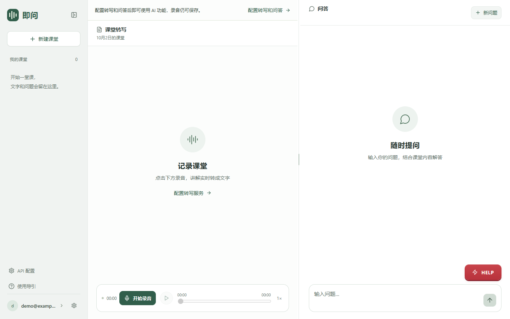

# 即问 · Jiwen

课堂录音、实时转写与 AI 问答应用。录下讲解，选中原文提问，或用 HELP 快速回答老师刚刚的问题；录音、文字和对话保存在自己运行的服务器。

支持中文和英文界面、邮箱注册登录、课堂管理、录音回放、Markdown 与数学公式。个人电脑可直接运行，服务器可通过 Docker Compose 部署。

## 视频展示

[](docs/media/jiwen-demo.mp4)

[查看原视频（含声音，约 23 秒）](docs/media/jiwen-demo.mp4) · [配乐署名](docs/media/README.md)

## 快速开始

需要 **Node.js 24 或更新版本**及其自带的 npm，支持 Windows、macOS、Linux。

```sh
git clone https://github.com/MrRoam/jiwen-classroom.git
cd jiwen-classroom
npm ci
npm run setup
npm run dev
```

打开 **http://localhost:4317**，点击“开始使用”，直接用邮箱和密码注册，无需邀请码。新实例首个邮箱账号是管理员。

**登录 → 侧栏「API 配置」→ 填写自己的密钥 → 保存配置 → 测试连接 → 开始录音。**

- 转写建议阿里云百炼，问答建议 Qwen。默认地址和模型已填好；使用百炼时可以复用一个 Key。
- 两项服务都允许自填密钥、地址和模型，兼容要求见 [API 配置](docs/API配置.md)。
- 不填写 API Key 也能启动、注册、录音保存和回放；真实转写及问答需要连接服务。
- 页面保存立即生效，无需重启。密钥只保存在服务器私有数据目录，不回显，不包含在仓库中。

Windows 也可双击 `启动.cmd`：安装依赖、构建并自动打开浏览器。使用期间保留终端；关闭窗口或按 Ctrl+C 停止服务。

`npm run setup` 只创建缺失的 `.env`，已有配置绝不覆盖。接口建议和示例不是附赠的 API 额度，云端调用的权限、余额与费用由你自己的账号承担。



## 使用方式

1. 开始录音并允许麦克风权限，界面显示收音状态及实时转写。
2. 直接输入问题，或选择一段讲解“就此提问”；可添加多处引用。
3. HELP 提供对老师最新问题的流式短答，可继续追问。
4. 每个对话使用独立的课堂背景快照，追问沿用该快照，不混入其他对话或后续课堂内容。
5. 暂停保存后回放，可拖动、倍速播放，点击转写时间跳到对应位置。

录音保存与转写独立。转写失败时仍会保存录音，可重连处理之后的音频；断线期间的文字不会自动补转。音频分段先保存在浏览器 IndexedDB，再顺序上传，重试去重，恢复网络后可补传。

## 配置入口

侧栏固定提供 **API 配置**，普通设置内也有同名入口。未配置时课堂页面提供“配置转写和问答”按钮。

| 内容 | 说明 |
| --- | --- |
| 页面配置 | 转写和问答的密钥、服务地址、模型、连接测试；仅管理员可修改 |
| 服务器 `.env` | 端口、监听地址、管理员邮箱、账号上限、额度、邮件与可选功能 |
| `data/` | 私有 API 配置、SQLite 数据库、课堂录音 |

页面保存到 `data/service-config.json`，字段优先于 `.env`，重启后保留。未保存的字段使用环境变量或默认值。有人正在录音、保存、回答或测试时不允许修改接口配置。

API Key、数据目录、数据库、证书和日志都不应提交到 Git。仓库 `.env.example` 的密钥全部为空，服务器也不会把完整密钥发送到浏览器。

## 常用命令

| 任务 | 命令 |
| --- | --- |
| 按锁文件安装依赖 | `npm ci` |
| 创建本机配置（不覆盖） | `npm run setup` |
| 开发启动 | `npm run dev` |
| 构建前端 | `npm run build` |
| 启动构建后的应用 | `npm start` |
| 全部 JavaScript 测试 | `npm test` |
| 发布内容检查 | `npm run check:release` |

依赖安装包含 FFmpeg 下载；若 `npm ci` 在这一步失败，检查网络、代理及平台支持，不要用忽略安装脚本的方式绕过音频依赖。

## 公网部署与可选能力

默认只监听本机 `127.0.0.1`。其他设备访问需要 HTTPS 才能获取麦克风；公网部署使用安全 Cookie，反向代理需支持 WebSocket 和问答 SSE。[Docker 部署、备份与恢复](deploy/README.md)提供具体步骤。

公开分享前，先在受控访问环境创建自己的管理员账号，再开放访问。已有实例保留原账号和数据；`ADMIN_EMAIL` 可以指定管理员账号。邮箱当前不验证所有权，适合由维护者管理的小型实例。

- [API 配置与接口兼容要求](docs/API配置.md)
- [账号与使用额度](docs/账号与额度.md)
- [课堂背景与时间轴](docs/课堂上下文与时间轴.md)
- [本地 faster-whisper 转写](docs/本地转写.md)
- [OpenRouter 可选路由](docs/OpenRouter优先路由.md)
- [Jev 重点标记与提问识别](docs/Jev重点标记.md)（默认关闭）

## 已知限制与验证

- 服务端单实例运行，SQLite 和录音存本地磁盘，需自行备份；不要并行启动使用同一数据库的服务。
- 浏览器退出后不会继续录音。手机锁屏、来电和切后台可能中断采集，使用时保持页面在前台。
- 断网时不要清除浏览器网站数据，尚未上传的分段只能在原设备、原浏览器及原账号恢复。
- 本地和模拟接口测试不代表你的密钥、实际麦克风或公网链路已验证。请分别测试连接并进行一次真实录音。
- 页面 API 配置不等于模型厂商管理台；程序内的账号额度不会修改云厂商账单。

测试使用临时数据库、模拟服务及合成音频，不使用真实密钥。覆盖账号隔离、直接注册、API 配置权限与持久化、独立上下文、HELP、录音顺序上传/去重、恢复和音频回放等行为。

## 技术与许可

前端 React + Vite，后端 Express + WebSocket + SQLite，音频转码使用 FFmpeg。源码使用 [MIT 许可证](LICENSE)，第三方组件分别遵循自己的许可，见 [第三方依赖说明](THIRD_PARTY_NOTICES.md)。仓库不分发 FFmpeg 二进制或模型权重。
