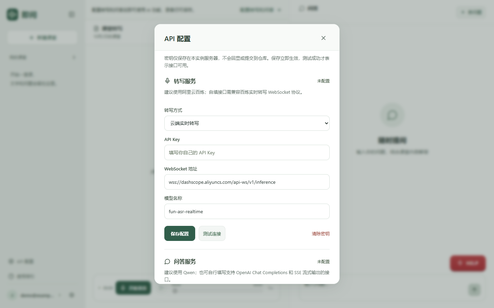

# API 配置

登录后点击侧栏 **API 配置**。侧栏折叠时使用同名图标，也可以从设置进入；首次使用的课堂页面会显示“配置转写和问答”按钮。

只有实例管理员可修改：新实例的首个邮箱账号自动成为管理员；已有实例使用最早的邮箱账号。可在服务器 `.env` 用 `ADMIN_EMAIL` 指定已有账号。请先在受控访问环境注册自己的管理员账号，再公开网站；邮箱字段本身不代表已验证邮箱所有权。

## 转写：建议阿里云百炼

选择“云端实时转写”，填写自己的 API Key，其余字段已提供默认值：

| 配置 | 默认值 |
| --- | --- |
| API Key | 留空，填写自己的百炼 Key |
| WebSocket 地址 | `wss://dashscope.aliyuncs.com/api-ws/v1/inference` |
| 模型名称 | `fun-asr-realtime` |

密钥、模型权限和服务地域必须匹配。使用业务空间或其他地域时填写服务商提供的对应地址。参见[百炼实时转写 API](https://help.aliyun.com/en/model-studio/fun-asr-real-time-speech-recognition-api-reference/)。

也可以自己填写地址和模型，但接口必须支持百炼实时转写的 `run-task`、`finish-task` 和结果事件协议，接收 16 kHz 单声道 PCM。仅替换地址无法接入协议不同的转写服务。

点击“保存配置”，再点“测试连接”。云端转写测试只验证任务能启动，不验证麦克风收音和实际识别；还需开始一次录音确认文字。

选择“本机 faster-whisper”前，先按[本地转写说明](本地转写.md)启动 Python 服务。

## 问答：建议 Qwen，可使用兼容接口

| 配置 | 默认值 |
| --- | --- |
| API Key | 独立密钥；也可勾选复用百炼转写密钥 |
| 接口基础地址 | `https://dashscope.aliyuncs.com/compatible-mode/v1` |
| 模型名称 | `qwen3.7-flash` |

Qwen 配置参见[模型说明](https://help.aliyun.com/zh/model-studio/qwen3-7-flash)。云端服务的权限、可用模型、价格和额度以控制台为准，运行开源代码不代表云端调用免费。

可以自行填写其他服务的密钥、基础地址及模型。程序向基础地址追加 `/chat/completions`，使用 Bearer 鉴权、`messages` 请求及 SSE 流式响应。响应需在 `choices[0].delta.content` 返回正文，并以结束事件或 `finish_reason` 结束。不要把完整 `/chat/completions` 路径重复填入基础地址。

百炼密钥只会自动复用到已支持的百炼官方地址。换成其他供应商时应填写该服务自己的密钥。公网接口使用 HTTPS/WSS；只有本机回环地址允许 HTTP/WS。地址中不能携带密钥、账号密码或查询参数。

点击“保存配置”，再点“测试连接”。问答测试会真实请求一句测试回答，可能计费，并计入问答额度。

“OpenRouter 路由（可选）”保留优先免费模型、额度保护和备用接口逻辑。优先路由失败或到达本地预留上限时，备用接口可能收费。HELP 优先使用直接配置的问答接口。

## 保存、生效和密钥

- 页面保存后立即生效，无需重启。存在录音、保存、回答或连接测试任务时，服务器拒绝修改，结束任务后重试。
- 页面配置保存在服务器 `data/service-config.json`；该目录被 Git 和 Docker 构建上下文排除。重启、更新代码保留配置。
- 服务器不会把完整密钥返回页面。空密钥输入表示保留原值；使用“清除密钥”可显式删除该服务密钥，且不会回退到 `.env` 中的旧密钥。
- 保存成功只表示设置已生效，只有连接测试通过才说明服务响应正常。
- 仍可在 `.env` 配置相同环境变量；页面保存的字段优先。未保存的字段沿用环境变量或默认值，修改 `.env` 需要重启。

## 常见问题

**没有 API Key 能启动吗？** 能。可注册、登录和录音保存、回放。真实转写和 AI 问答需要配置服务。

**我看得到入口但不能编辑？** 当前账号不是实例管理员，联系该实例的维护者。自行 clone 运行的新实例，首个邮箱账号就是管理员。

**测试通过却没有转写？** 云端测试不采集麦克风。检查录音权限、输入音量、当前麦克风和录音时的转写连接状态。

**保存时提示有人正在使用？** 为避免改变使用中会话的接口配置，等待任务完成后再保存。

## 页面入口

